# ASPARe

**Automated Security Posture Assessment & Remediation Engine**  
*Automated Cloud Storage Misconfiguration Detection & Remediation*

> ASPARe discovers cloud storage buckets, detects misconfigurations with reviewed policies, fuses rule evidence with
> behavioural and business-context evidence into a confidence and priority, remediates automatically where it is safe,
> verifies every fix by re-reading the cloud, and records an audit trail. It runs on **AWS S3** (verified on a real
> account), **Azure Blob Storage** and **Google Cloud Storage** (adapter logic tested against simulated APIs).

The intelligence layer is deliberately **advisory where it matters**: fusion can lower an automatic fix to an alert but
never raise one to automatic, and the LLM only explains and recommends, it never acts.

**Use it:** <https://aspare.vercel.app>. Sign in, press one button in your AWS console, done. Details in
[docs/HOSTED.md](docs/HOSTED.md). The sections below describe the engine and the self-hosted tooling.

## What is in the box

| Area | What it does | Verified how |
| --- | --- | --- |
| Detection + risk + remediation + verification + audit | Five controls across three clouds, safety gate (allowlist + tag), re-read verification | Unit/integration tests; live AWS runs |
| Fusion engine | Behavioural anomaly signals, context rules, evidence-weighted confidence, priority, incident correlation | Tests + [benchmark](docs/research/benchmark.md) (synthetic, see caveats) |
| LLM analysis | Claude explains root cause, impact and recommendation; offline fallback when no key | Fake-client tests; **not run live without your API key** |
| Least-privilege policy generator | Minimal IAM policies from the actions ASPARe really runs; drift test against the deployed template | Test records every real S3 API call |
| Azure + GCS adapters | Same rules, fusion and remediation through a routing layer | Simulated APIs; real SDK wrappers **not run against live Azure/GCP** |
| Live Showcase + Intelligence dashboard | Break a real bucket and watch ASPARe fix it, with reasoning | Run against a real AWS account |
| AWS deployment | Two Lambdas, finding bus, SNS alerts, audit bucket | Deployed; scheduled/manual path verified, see [GOING_LIVE](docs/GOING_LIVE.md) for the CloudTrail caveat |

See [docs/IMPLEMENTATION_STATUS.md](docs/IMPLEMENTATION_STATUS.md) for the honest per-item status and limits.

## Quick start

```bash
python -m venv .venv
source .venv/bin/activate
pip install -e ".[dev,dashboard]"

pytest
python -m aspare.cli --mode dataset
streamlit run dashboard/app.py
```

```bash
make check        # ruff + mypy + pytest + docs
make dashboard    # Streamlit: Recorded lab (no AWS needed) or Live AWS
```

The **Live Showcase** page (`make showcase`) breaks a throwaway bucket in your AWS account on purpose and streams ASPARe
detecting, reasoning about, fixing and verifying it in real time.

The dashboard has two data sources: a **recorded lab** (42-bucket estate on a mocked S3, needs no AWS account) and
**Live AWS** (read-only scan of your account with per-finding human approval). See
[docs/GOING_LIVE.md](docs/GOING_LIVE.md) for the AWS steps only you can perform.

The mocked demo creates an isolated insecure bucket with [moto](https://docs.getmoto.org/), runs the real pipeline, and writes `var/audit/aspare.jsonl`. Refresh the dashboard after the demo.

Live AWS is opt-in and **creates its own uniquely named bucket**:

```bash
python -m aspare.cli --mode live --confirm ASPARE-LIVE-DEMO --cleanup
```

## Architecture

```mermaid
flowchart LR
    CloudTrail[CloudTrailManagementEvents] --> DetectionLambda[DetectionLambda]
    InventorySchedule[ScheduledInventoryScan] --> DetectionLambda
    DemoCLI[MockedOrLiveDemoCLI] --> DetectionWorkflow[DetectionWorkflow]
    DetectionLambda --> EventNormalizer[EventNormalizer]
    EventNormalizer --> StorageInventory[StorageInventory]
    StorageInventory --> S3Inspector[S3Inspector]
    S3Inspector --> DetectionEngine[DetectionEngine]
    PolicyKnowledgeBase[PolicyKnowledgeBase] --> DetectionEngine
    DetectionEngine --> FindingNormalizer[FindingNormalizer]
    FindingNormalizer --> RiskEvaluator[RiskEvaluator]
    PolicyKnowledgeBase --> RiskEvaluator
    RiskEvaluator -->|"AUTO_REMEDIATE"| FindingBus[ASPAReEventBus]
    RiskEvaluator -->|"ALERT_AND_LOG or LOG_ONLY"| AuditRepository[AuditRepository]
    FindingBus --> RemediationLambda[RemediationLambda]
    RemediationLambda --> RemediationEngine[RemediationEngine]
    RemediationEngine --> S3Remediator[S3Remediator]
    S3Remediator --> VerificationEngine[VerificationEngine]
    VerificationEngine --> S3Inspector
    VerificationEngine --> AuditRepository
    DetectionWorkflow --> AuditRepository
    AuditRepository --> ReportingAggregator[ReportingAggregator]
    ReportingAggregator --> StreamlitDashboard[StreamlitDashboard]
```



Detection never receives a write-capable AWS client. A successful `Put*` API response is not treated as success until the originating detector is re-run against a fresh inventory snapshot.

## Documentation map

- [Documentation home](docs/README.md)
- [Architecture overview](docs/architecture/overview.md)
- [Detection engine](docs/architecture/detection-engine.md)
- [Remediation engine](docs/architecture/remediation-engine.md)
- [Verification](docs/architecture/verification.md)
- [Infrastructure](docs/architecture/infrastructure.md)
- [Threat model](docs/security/threat-model.md)
- [Permissions](docs/security/permissions.md)
- [Detection rules](docs/implementation/detection-rules.md)
- [Remediation rules](docs/implementation/remediation-rules.md)
- [Going live on AWS](docs/GOING_LIVE.md)
- [Demo guide](docs/DEMO_GUIDE.md)
- [Glossary](docs/GLOSSARY.md)
- [Legacy prototype](legacy/README.md)

## Technology stack

- Python 3.11+ (developed against 3.14)
- boto3 for AWS S3
- EventBridge + Lambda for the optional deployed path
- Streamlit for the local dashboard
- pytest + moto for tests and the mocked demonstration
- CloudFormation for demonstration-grade infrastructure

## Safety

ASPARe remediates only buckets that are allowlisted **and** tagged `ASPAReDemo=true` by default. It does not delete unrelated bucket policies, does not touch IAM users or security groups from the original prototype, and does not scan Azure or GCP.
