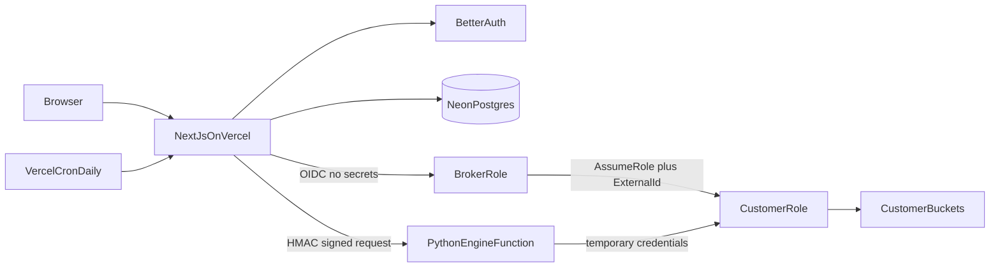

# Hosted ASPARe

> The product people actually use: sign in, press one button in AWS, and ASPARe watches and protects the account.
> Everything runs on free tiers.

Live site: <https://aspare.vercel.app>

## How a visitor connects

1. **Sign in.** Email and password (Better Auth), stored in Postgres. GitHub and Google sign-in switch on when the
   matching `*_CLIENT_ID` / `*_CLIENT_SECRET` variables are set.
2. **Connect AWS.** The visitor enters their account id. ASPARe returns a CloudFormation quick-create link with every
   parameter prefilled (role name, a private external id, ASPARe's account id) and a short-lived link to a private
   template. The visitor ticks the IAM box and presses Create stack.
3. **Automatic detection.** The dashboard polls `POST /api/connections/:id/verify`, which assumes the new role through STS.
   When it works, the connection turns green and the first scan starts. Nothing is pasted back.
4. **Optional fixing.** A second stack creates a separate fix role limited to five `Put*` actions on buckets tagged
   `aspare-autofix=true`. Watching never needs write permission.

## Architecture



- **Keyless.** Vercel's OIDC token is exchanged for the `aspare-vercel-broker` role. No AWS access key exists anywhere.
- **Engine isolation.** The Python function (`web/api/engine.py`) only accepts requests signed with `ENGINE_SECRET`
  (HMAC-SHA256 over `timestamp.body`, five-minute window). It receives one-hour credentials per call and keeps none.
- **Same engine as the demo.** `web/api/_engine` is a synced copy of `src/aspare` and `config/`; a test fails if they drift
  and another proves the copy works in a clean interpreter.

## Free stack

| Need | Service | Free-tier notes |
| --- | --- | --- |
| Hosting, serverless Node and Python, cron | Vercel Hobby | Functions up to 300 s; cron once a day; **Hobby is for non-commercial use** |
| Database | Neon Postgres (Vercel Marketplace) | Small free allowance; scale-to-zero |
| Auth | Better Auth, stored in the same Postgres | Open source, no per-user fees |
| AWS identity | OIDC federation | No cost |
| Email | none | Email verification is off until a provider is added |

## One-time AWS setup (the single command)

The application needs one identity in the ASPARe AWS account. Run from the repository root with credentials for that
account:

```bash
aws cloudformation deploy \
  --template-file deploy/aspare-broker.yaml \
  --stack-name aspare-broker \
  --capabilities CAPABILITY_NAMED_IAM \
  --region ap-southeast-2
```

It creates the Vercel OIDC provider and the `aspare-vercel-broker` role, trusted only by the `aspare` project in
production.

## Environment variables (production)

| Variable | Purpose |
| --- | --- |
| `DATABASE_URL` | Neon, injected by the Marketplace integration |
| `BETTER_AUTH_SECRET`, `ENGINE_SECRET`, `CRON_SECRET` | Random secrets generated at setup |
| `TRUST_ACCOUNT_ID`, `AWS_ROLE_ARN`, `AWS_REGION`, `ASPARE_AWS_REGION`, `TEMPLATE_BUCKET` | AWS broker configuration |
| `GITHUB_CLIENT_ID/SECRET`, `GOOGLE_CLIENT_ID/SECRET` | Optional social sign-in |

## Operating limits

Five connected accounts per user, 200 buckets per scan, daily automatic scans, last five scans kept per account.
Account deletion (`DELETE /api/me`) erases the user, connections, scans, audit entries and sessions.

## Local development

```bash
cd web && npm install
python3 scripts/dev_api.py   # Python functions on :8000
npm run dev                  # site on :3000, embedded Postgres, no accounts needed
```

## Verification status

Verified on a real AWS account: the read-only role created from the CloudFormation template, assumed with the external
id, and a full scan of the account. Production sign-in, database, Python engine and account deletion verified live.
**Not yet verified:** the hosted fix flow and the tag condition inside the fix role on real buckets (covered by
simulated-AWS tests), and the production OIDC broker until the command above is run.
