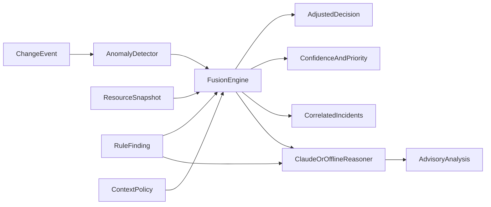

# Intelligence layer

> Behavioural anomaly signals, business-context rules, an evidence-weighted confidence, incident correlation and
> LLM-assisted explanation, all layered on the deterministic core without replacing it.

## Overview

## How it works

1. **Anomaly signals** (`anomaly.py`). For a change event, five signals are computed from real evidence: a root or
   otherwise privileged actor, the riskiness of the API call (a four-flag Public Access Block disable scores higher than a
   partial change), a burst of risky changes by one actor in 15 minutes, an actor never seen before (only once enough
   history exists), and activity outside the actor's learned hours. Signals combine by noisy-OR with configured weights
   (`config/fusion-policy.json`). With no event (a scheduled scan) there is no behavioural evidence and no score.
2. **Context rules** (`config/context-policy.json`) are data, not code: intended-public buckets cap the decision at an
   alert, scratch/cache buckets cap versioning findings at log-only, regulated data classes and production raise priority.
3. **Confidence** starts at 0.97 for a control read directly from the cloud API (0.6 if the inspection reported errors),
   adds context deltas, then is corroborated by the anomaly score. **Priority** = severity weight x confidence x
   context multipliers + an anomaly bonus.
4. **Decision adjustment.** An automatic fix is lowered to an alert if a context rule says the exposure may be
   intentional, or if confidence falls below the auto-remediation floor (0.65). Fusion **never raises** a decision to
   automatic. A strongly anomalous finding that is not auto-fixed is flagged `escalate`.
5. **Correlation** groups findings into incidents: a public-exposure chain (open Public Access Block plus a public ACL),
   a compound misconfiguration (three or more weaknesses on one resource) or an actor campaign (anomalous changes by one
   actor on three or more resources).
6. **Reasoner** (`reasoner.py`). Claude receives the structured evidence inside `<finding_data>` tags with a system prompt
   that marks it as untrusted data, and returns JSON (summary, root cause, business impact, recommendation, alternatives,
   caveats). Refusals, outages and malformed replies degrade to the offline reasoner and say so. It never executes anything.

Every fusion result is written to the audit trail (`FUSION_EVALUATED`) with all reasons.

## Security considerations

- Resource names, tags and policy text can be attacker-controlled, so they are only passed to the model as data and the
  model has no tools.
- Fusion cannot widen what ASPARe does automatically; the safety gate (allowlist + tag) still applies to every write.
- Confidence is a transparent heuristic, not a calibrated probability, and is documented as such.

## Failure scenarios

No API key: the offline reasoner is used. LLM error or refusal: offline analysis with a caveat. No event history: novelty
and hour-profile signals are skipped, not guessed.

## Example

`ASPARE_LLM_MODEL` selects the Claude model (default `claude-opus-5-5`). Disable fusion with `ASPARE_FUSION=false`.

## Testing

`tests/unit/test_intelligence.py`, `tests/unit/test_reasoner.py` and the rule-only vs fused
[benchmark](../research/benchmark.md), which is synthetic and project-labelled (read its caveat).

## Future improvements

Persist the behavioural baseline, collect independent labels, and calibrate confidence against reviewed outcomes.
