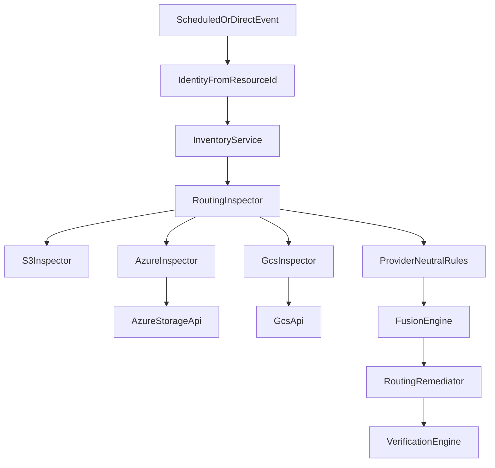

# Multi-cloud

> One pipeline, three clouds. Azure Blob Storage and Google Cloud Storage reuse the same detection rules, fusion,
> safety gate, remediation and verification as AWS S3.

## Overview

## How it works

Resource ids carry a scheme: AWS keeps the plain bucket name, Azure is `azure://account`, GCS is `gcs://bucket`. A
router sends inspection, remediation, tag reads (for the safety gate) and verification to the right adapter. Each adapter
maps the cloud's native settings into the provider-neutral `StorageResource`:

| Control | AWS S3 | Azure Blob | Google Cloud Storage |
| --- | --- | --- | --- |
| Public access block | Four Public Access Block flags | `allowBlobPublicAccess` is false | Public access prevention enforced + uniform bucket-level access |
| Public exposure grants | ACL grants to AllUsers/AuthenticatedUsers | Containers with blob/container public access | IAM bindings for allUsers/allAuthenticatedUsers |
| Encryption | Default encryption config | Always on (reported AES256) | Always on (reported AES256) |
| Versioning | Bucket versioning | Blob service versioning | Object versioning |
| HTTPS only | Bucket policy denies `aws:SecureTransport=false` | "Secure transfer required" | Not applicable |

The cloud calls sit behind `AzureStorageApi` and `GcsApi`. `providers/azure/sdk.py` and `providers/gcp/sdk.py` implement
them over the vendor SDKs (`pip install "aspare[azure]"` / `"aspare[gcp]"`).

## Configuration

- Azure: `ASPARE_AZURE_SUBSCRIPTION_ID`, `ASPARE_AZURE_RESOURCE_GROUP`, credentials via `DefaultAzureCredential`
  (`az login`).
- GCP: `ASPARE_GCP_ENABLED=true`, `ASPARE_GCP_PROJECT`, credentials via `gcloud auth application-default login`.
- Remediation still requires the resource id in `ASPARE_ALLOWED_BUCKETS` and the demo tag (Azure tag `ASPAReDemo=true`,
  GCS label `asparedemo=true`).

## Security considerations

GCS label keys are lowercase, so the adapter maps `asparedemo`/`dataclass`/`purpose`/`environment` back to the canonical
tag names. Public IAM members are removed individually; private bindings are preserved.

## Failure scenarios

An unconfigured cloud raises a clear "adapter is not configured" error with the setting to change. A missing resource is
reported as not found.

## Testing

`tests/integration/test_multicloud.py` runs the full pipeline for Azure, GCS and all three clouds together against
`aspare.providers.simulated`. **The real SDK wrappers have not been run against live Azure or GCP.**

## Future improvements

Cloud-specific controls (Azure minimum TLS, GCS retention) and neutral rule ids (findings keep the `S3_` prefix).
