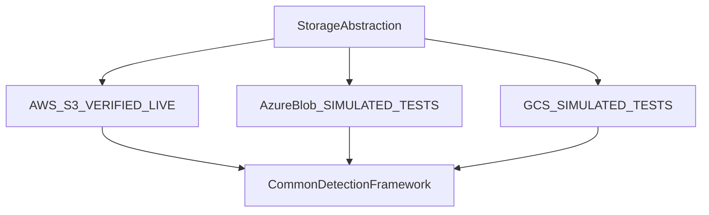

# Future work

> The Review I capability list is implemented. This page records what remains, honestly.

## Implemented from the original roadmap

LLM-assisted analysis and recommendations, least-privilege policy generation (with human review), anomaly signals,
rule + anomaly + context fusion, evidence-weighted confidence, false-positive reduction and correlation, Azure Blob and
Google Cloud Storage adapters, alert delivery (SNS), approval UX, and a rule-only vs fused benchmark. See
[intelligence](../architecture/intelligence.md) and [multi-cloud](../architecture/multi-cloud.md).

## Still open

- Run the Azure and GCS SDK wrappers against live accounts and add their cloud-specific controls (for example Azure
  minimum TLS version, GCS retention policies).
- Persist the anomaly baseline (DynamoDB or the audit bucket) so it survives Lambda cold starts.
- Independent labels for the benchmark and a larger case set, to move from regression checks to measured accuracy.
- Dashboard authentication and hosting; multi-account scanning; dead-letter queues.
- A provider-neutral rule id scheme (today Azure/GCS findings reuse `S3_*` ids).
- Fully managed CloudTrail trail inside the CloudFormation template.

